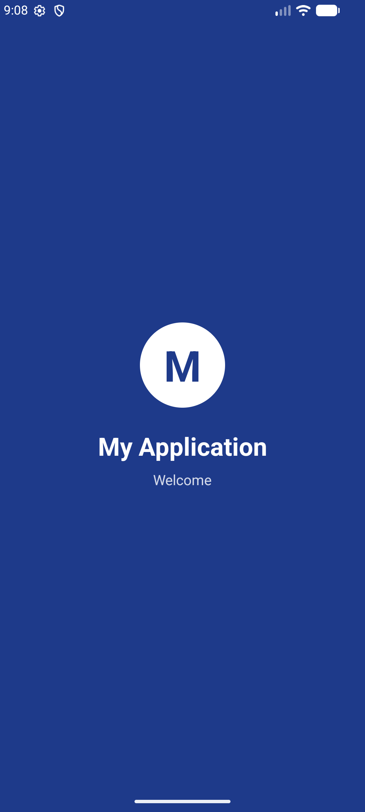
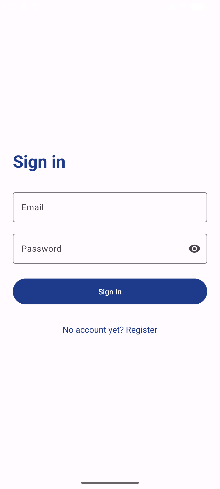
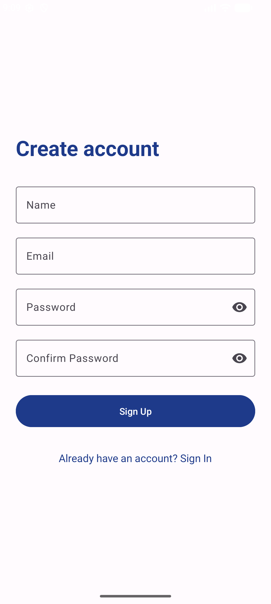

My Application

Student Name:Daniel Suleimanau

About the App

This Android application consists of three screens:

1. Splash Screen
The welcome screen displayed when the application starts.

2. Login Screen
Allows users to enter their email and password to sign in.

3. Register Screen
Allows new users to enter their name, email, password, and confirm their password.

Technologies Used
- Java
- XML
- Android Studio
- Material Design Components
